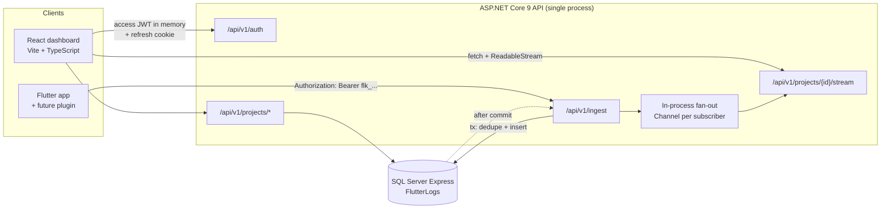
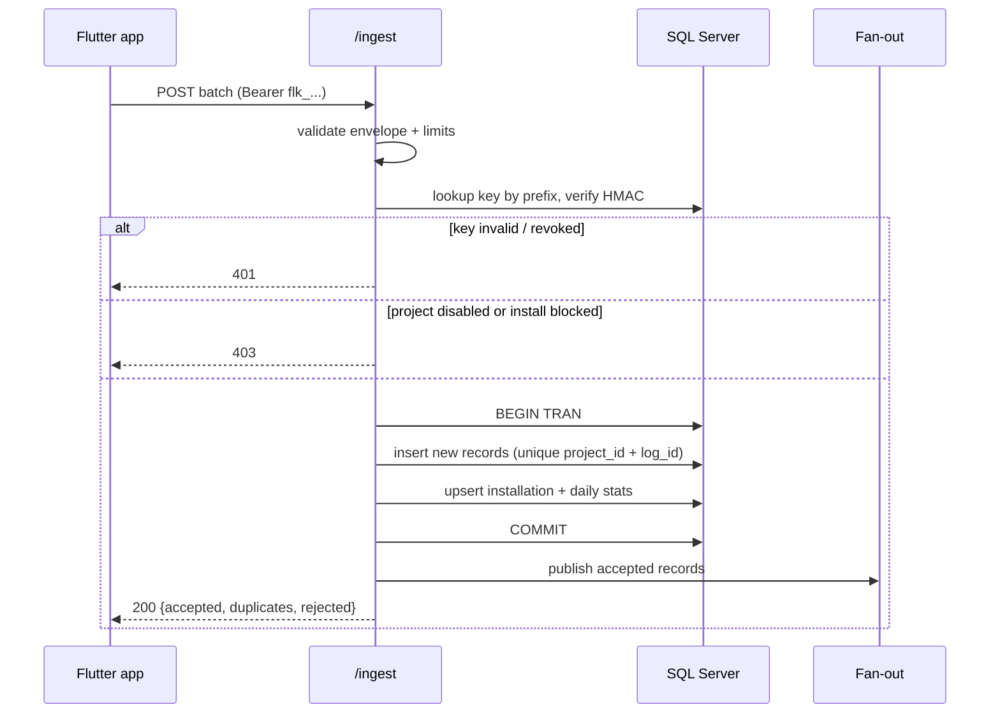

# Architecture

Status: approved baseline (Phase 0) · Last updated: 2026-10-29

## 1. Context

One deployable backend, one deployable frontend, one relational database. No queue, no cache,
no object storage, no microservices. Every addition in this document is justified by a named
upgrade trigger, not by anticipated growth.



## 2. Stack

| Layer | Choice | Rationale | Trade-off |
|---|---|---|---|
| Frontend | React 19, Vite 8, TypeScript, Tailwind v4 | Scaffold exists; TS for a data-heavy UI; Tailwind for speed | Tailwind markup noise |
| Data fetching | TanStack Query (Phase 2) | Cache, retry, invalidation | One more dependency |
| Backend | ASP.NET Core 9, Minimal APIs | Typed, fast, native JWT/rate-limit/SSE support | .NET 9 is past support; upgrade planned (ADR-0008) |
| ORM | EF Core 9, SQL Server provider | Migrations, LINQ, parameterized SQL | Provider-specific migrations |
| Validation | FluentValidation (Phase 2) | Explicit rules, testable | Extra package |
| Real-time | SSE + `System.Threading.Channels` | One-way, simple, reconnect-friendly | Single-instance fan-out |
| Jobs | `IHostedService` | Retention sweeper, stats flush | No durable job store |
| Logging | Serilog (JSON console) + correlation IDs | Structured, greppable | None material |
| Tests | xUnit, WebApplicationFactory, Respawn; Vitest, RTL, Playwright; k6 | Layered confidence without Docker | Integration tests need local SQL Server |

## 3. Module boundaries (API)

```
Features/Auth          register, login, refresh, logout, verify, reset
Features/Projects      project CRUD, stats, purge
Features/Keys          create / rotate / revoke ingestion keys
Features/Ingest        envelope validation, key auth, dedupe, persistence, publish
Features/Logs          query, filters, cursor pagination, detail
Features/Installations list, label, block
Features/Stream        SSE endpoint + subscriber registry
Infrastructure         persistence, auth handlers, rate limiting, background services
Common                 ProblemDetails, correlation ID, clock, results
```

Rules:
- A feature may depend on `Infrastructure` and `Common`, never on another feature.
- No endpoint queries `logs` directly: it must resolve a project through `Projects.OwnedBy(userId)`
  first. This is the enforcement point for tenant isolation.
- Domain code takes `TimeProvider`, never `DateTime.Now`.

## 4. Ingestion flow



Durability rule: the response is produced **after** `COMMIT`. Fan-out happens after the response
data is materialized; a failure to publish never invalidates stored logs, and the client's REST
backfill recovers anything the stream missed.

## 5. Live delivery

- Transport: `text/event-stream`, consumed with `fetch()` + `ReadableStream` so the access JWT can
  travel in the `Authorization` header (browser `EventSource` cannot set headers).
- Registry: `ConcurrentDictionary<Guid, List<Subscriber>>` keyed by project id. Each subscriber
  holds a bounded `Channel<LogEvent>` (capacity 1 000).
- Event shape: `id: <received_at_ticks>-<row_id>`, `event: log`, `data: <json>`.
- Backpressure: when a channel is full, enqueue a single `event: overflow` and stop writing; the
  client refetches from its last cursor. Memory stays bounded.
- Reconnect: `GET /stream?since=<cursor>` replays committed logs after `since` (capped at 500),
  then continues live. The client also pages REST for the remainder.
- Heartbeat: SSE comment every 15 s so dead connections are detected by proxies.

## 6. Configuration

| Key | Purpose | Secret |
|---|---|---|
| `ConnectionStrings__Default` | SQL Server connection | No (Windows auth in dev), yes in production |
| `Jwt__SigningKey` | HS256 signing key, ≥ 32 bytes | Yes |
| `Jwt__Issuer`, `Jwt__Audience` | Token validation | No |
| `Ingest__Pepper` | HMAC pepper for ingestion keys | Yes |
| `Logs__RetentionDays` | Retention window (default 30) | No |
| `Auth__DevEmailMode` | Print links to console | No |
| `Ingest__MaxRecordsPerBatch` | Default 500 | No |

Development secrets live in `dotnet user-secrets`. Nothing sensitive is committed.

## 7. Scaling triggers

| Symptom | Action |
|---|---|
| > 1 API instance needed | Replace in-process fan-out with Redis pub/sub (`ILogStream` seam already exists) |
| > 100k logs/day or > 3 GB | Partition `logs` by month, archive cold partitions |
| Text search > 300 ms | Enable SQL Server full-text index, then consider a dedicated search store |
| Ingest > 100 ms p95 | Batch insert tuning, disable per-record round trips |
| > 1 M logs/day | Introduce an append-only store + async ingestion queue |
| Multi-region / compliance | Revisit hosting, encryption at rest, data residency |

## 8. Reference package assessment

`ql_logger_flutter` 0.0.6, MIT-0, verified from pub.dev and its GitHub source.

Adopted concepts: minimal init, single-call logging, periodic flush, upload result callbacks.

Rejected with reasons:

| Reference behaviour | Why rejected |
|---|---|
| `content` is one pre-formatted text blob | Cannot filter by level/time/device without parsing |
| `project` = app name | Names are mutable and non-unique; routing needs an immutable id |
| Upload whole daily file, clear on success | Duplicates when a response is lost; data-loss windows |
| `Authorization: <raw token>` | Needs a scheme + explicit status semantics |
| Android `androidInfo.id` as device id | Build id, identical across devices of the same build |
| Uploads ~35 permission statuses | Disproportionate data collection |
| Regex that redacts all URLs/domains | Destroys the context developers need |

Our plugin (Phase 9) is a new implementation with a structured, batched, idempotent contract.

## 9. Deployment topology (Phase 8 target)

Single Linux host or PaaS: API container/process + managed SQL Server/Postgres + static frontend
build, TLS terminated in front of both. `dotnet ef database update` runs as an explicit release
step, never implicitly in production. Backups and a restore drill are part of Phase 8 acceptance.
