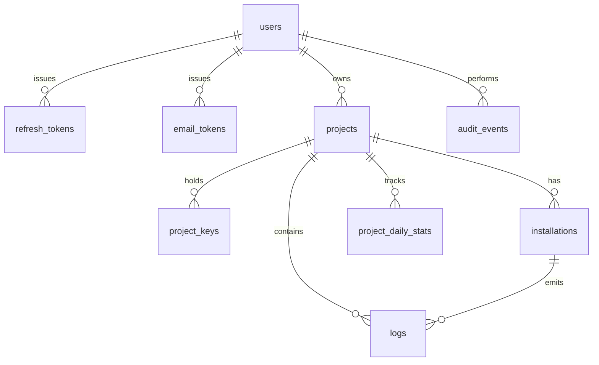

# Data Model

Status: approved baseline (Phase 0); Phase 3 tables implemented, Phase 4 tables planned · Last updated: 2026-10-30 · Database: SQL Server 2022 Express

## 1. Entity relationships

Ownership is single-level: `projects.owner_user_id → users.id`. There is no membership table in
the MVP (ADR-0001 covers the future path).

## 2. Tables

### users

| Column | Type | Notes |
|---|---|---|
| id | uniqueidentifier PK | `NEWSEQUENTIALID()` default not required; ids are generated in app |
| email | nvarchar(320) | stored `Trim().ToLowerInvariant()` |
| password_hash | nvarchar(255) | Argon2id PHC string, parameters embedded |
| display_name | nvarchar(80) NULL | optional |
| email_verified_at | datetime2 NULL | null = unverified |
| status | tinyint | 0 active, 1 disabled |
| created_at / updated_at | datetime2 | UTC |

Unique index: `UX_users_email (email)`.

### refresh_tokens

| Column | Type | Notes |
|---|---|---|
| id | uniqueidentifier PK | |
| user_id | uniqueidentifier FK → users, cascade | |
| family_id | uniqueidentifier | rotation family |
| token_hash | binary(32) | SHA-256 of the opaque token |
| created_at / expires_at | datetime2 | 7-day TTL |
| revoked_at | datetime2 NULL | |
| replaced_by_id | uniqueidentifier NULL | rotation chain |

Indexes: `IX_refresh_tokens_user (user_id)`, `UX_refresh_tokens_hash (token_hash)`.

### email_tokens

| Column | Type | Notes |
|---|---|---|
| id | uniqueidentifier PK | |
| user_id | uniqueidentifier FK, cascade | |
| purpose | tinyint | 0 verify, 1 reset |
| token_hash | binary(32) | single use |
| expires_at | datetime2 | 24 h / 1 h |
| used_at | datetime2 NULL | |

### projects

| Column | Type | Notes |
|---|---|---|
| id | uniqueidentifier PK | immutable public id |
| owner_user_id | uniqueidentifier FK → users | cascade delete |
| name | nvarchar(80) | label only, not unique |
| description | nvarchar(500) NULL | |
| ingest_enabled | bit | default 1 |
| created_at / updated_at | datetime2 | |
| archived_at | datetime2 NULL | soft delete, 7-day recovery window |

Index: `IX_projects_owner (owner_user_id, archived_at)`.

### project_keys

| Column | Type | Notes |
|---|---|---|
| id | uniqueidentifier PK | |
| project_id | uniqueidentifier FK, cascade | |
| prefix | char(8) | indexed lookup, non-secret |
| key_hash | binary(32) | HMAC-SHA256(secret, pepper) |
| label | nvarchar(60) NULL | |
| created_at | datetime2 | |
| last_used_at | datetime2 NULL | updated at most once per minute |
| grace_until | datetime2 NULL | rotation window, max 24 h |
| revoked_at | datetime2 NULL | |

Indexes: `UX_project_keys_prefix (prefix)`, `IX_project_keys_project (project_id, revoked_at)`.

Constraint in application logic: at most two keys per project with `revoked_at IS NULL` and an
unexpired grace window. Expired grace rows remain as history and do not count toward the cap.

### installations

| Column | Type | Notes |
|---|---|---|
| id | uniqueidentifier PK | internal |
| project_id | uniqueidentifier FK, cascade | |
| installation_id | uniqueidentifier | client-generated; **not** a hardware id |
| label | nvarchar(80) NULL | owner-editable |
| platform | nvarchar(20) NULL | `android`, `ios`, `web`, `windows`, … |
| os_version | nvarchar(40) NULL | |
| app_version | nvarchar(40) NULL | |
| first_seen_at / last_seen_at | datetime2 | |
| blocked_at | datetime2 NULL | blocks future ingestion |

Unique index: `UX_installations_project_installation (project_id, installation_id)`.

### logs

| Column | Type | Notes |
|---|---|---|
| id | bigint identity PK | internal ordering key; never exposed |
| project_id | uniqueidentifier FK, cascade | |
| installation_ref | uniqueidentifier NULL FK → installations.id | nullable if upsert failed |
| log_id | uniqueidentifier | client-generated (UUIDv7 preferred) |
| level | tinyint | 0 debug, 1 info, 2 warning, 3 error, 4 fatal |
| message | nvarchar(2000) | truncated beyond, flagged in metadata? no — rejected if too long |
| stack_trace | nvarchar(max) NULL | capped at 64 KB by API |
| metadata | nvarchar(max) NULL | JSON text, capped at 16 KB |
| session_id | nvarchar(64) NULL | |
| client_timestamp | datetime2 | app clock |
| received_at | datetime2 | server clock, default `SYSUTCDATETIME()` |
| app_version | nvarchar(40) NULL | snapshot at ingest |
| platform | nvarchar(20) NULL | snapshot at ingest |
| os_version | nvarchar(40) NULL | snapshot at ingest |

Unique index: `UX_logs_project_logid (project_id, log_id)` — the idempotency key.

Query indexes:
- `IX_logs_project_received (project_id, received_at DESC, id DESC)` — feed + cursor paging
- `IX_logs_project_level_received (project_id, level, received_at DESC)`
- `IX_logs_project_installation_received (project_id, installation_ref, received_at DESC)`
- `IX_logs_project_client_ts (project_id, client_timestamp)`

### project_daily_stats

| Column | Type | Notes |
|---|---|---|
| project_id | uniqueidentifier PK part | |
| day | date PK part | UTC day |
| log_count | int | |
| error_count | int | level ≥ 3 |
| bytes | bigint | approximate payload bytes |

Primary key `(project_id, day)`. Upserted inside the ingest transaction — avoids `COUNT(*)` scans
on the dashboard. Phase 3 reads this table for project summaries and returns zero buckets until
Phase 4 starts writing rows; `lastLogAt` is `null` until then.

### audit_events

| Column | Type | Notes |
|---|---|---|
| id | bigint identity PK | |
| user_id | uniqueidentifier NULL | null for unauthenticated attempts |
| project_id | uniqueidentifier NULL | |
| action | nvarchar(60) | `auth.login`, `key.create`, `key.revoke`, `project.purge`, … |
| target_type / target_id | nvarchar(40) / nvarchar(64) NULL | |
| metadata | nvarchar(max) NULL | JSON, no secrets, no log bodies |
| created_at | datetime2 | |

## 3. Timestamps

- All persisted timestamps are `datetime2` in **UTC**. The API serializes ISO-8601 with `Z`.
- `received_at` drives ordering and retention. `client_timestamp` is diagnostic only.
- A client timestamp more than 24 h in the future is clamped to server time and the record is
  flagged; clocks are never trusted for ordering.
- The UI renders in the viewer's local timezone; the API never returns local times.

## 4. Retention and deletion

- Default window: 30 days (`Logs__RetentionDays`), applied to `received_at`.
- Nightly `RetentionSweeper` (`IHostedService`) deletes in batches of 5 000 with a 200 ms pause to
  keep the transaction log small; loop until no rows remain.
- Owner-triggered purge deletes one project's logs with the same batching.
- Archiving a project hides it; logs are retained for 7 days, then purged by the sweeper.
- Deleting a user or project cascades keys, installations, stats, and logs via FK cascade.

## 5. Expected volume (tier S)

10 000 logs/day × 500 B ≈ 5 MB/day ≈ 150 MB/month ≈ 1.8 GB/year. SQL Server Express caps a
database at 10 GB, so the MVP has multiple years of headroom. Revisit at 3 GB (see
`docs/architecture.md` §7).

## 6. Migrations

- EF Core migrations, committed to `api/src/FlutterLogs.Api/Infrastructure/Persistence/Migrations`.
- Development: applied explicitly with `dotnet ef database update` (never silently on startup).
- Other environments (Phase 8): the same command as a release step, never automatic.
- Every migration must be reversible or explicitly documented as forward-only.

## 7. Integrity rules

1. `logs.project_id` must reference an existing project; FK cascade on project deletion.
2. `(project_id, log_id)` uniqueness is the idempotency contract. Violations are counted as
   duplicates, not surfaced as errors.
3. `installations` uniqueness is `(project_id, installation_id)`; two projects may legitimately
   see the same client UUID without linking them.
4. No query may return rows for a project the caller does not own. Enforced in the repository
   layer and verified by negative integration tests for every endpoint.
